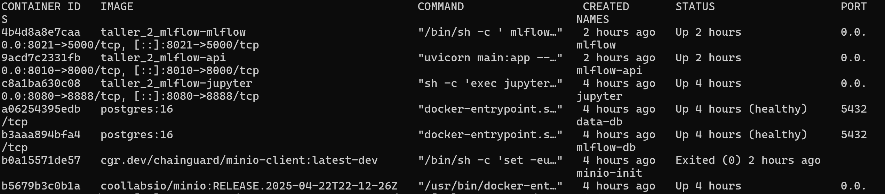
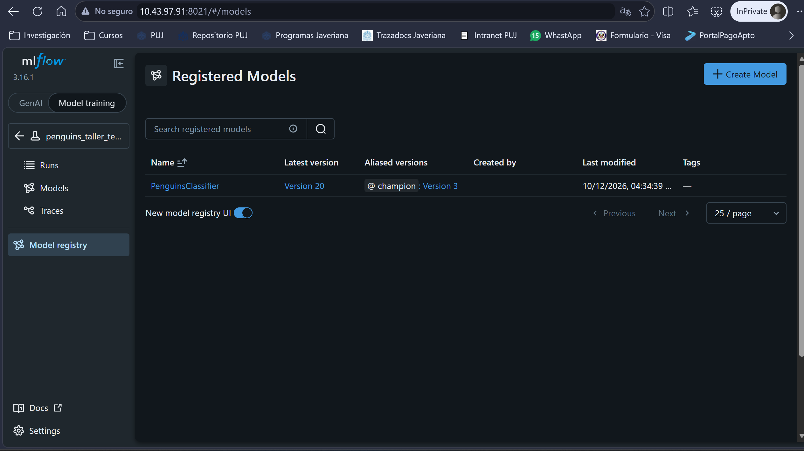
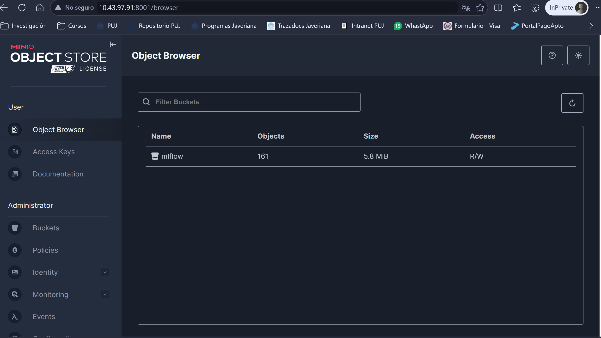
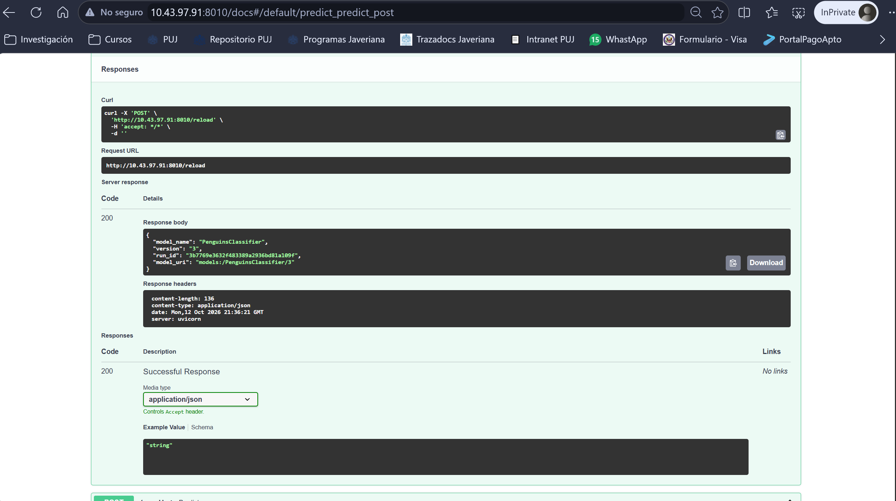

# Taller 2 — MLflow, PostgreSQL, MinIO, Jupyter y FastAPI

## Objetivo y arquitectura

Se implementa un flujo que integra servicios como PostgreSQL, Jupyter, MinIO, MLflow y FastAPI para un solo modelo de apredizaje automático **Random Forest** que clasifica las especies de pingüinos de un conjunto de datos en formato **CSV**. Se alamacenan datos y metadatos en un BD PostgreSQL, los artefactos generados en MinIO, y veite (20) ejecuciones del modelo en MLflow. El servicio encargado de ejecutar el modelo es Jupyter. La inferencia y selección del modelo se ejecuta en FastAPI

| Servicio | Función | Acceso desde el la máquina virtual (MV) asignada |
| --- | --- | --- |
| `data-db` (PostgreSQL 16) | Datos originales y procesados | Interno |
| `mlflow-db` (PostgreSQL 16) | Metadatos de experimentos y modelos | Interno |
| `minio` / `minio-init` | Objetos S3 / inicialización del bucket `mlflow` | PORT: | `:8000` / consola `:8001` |
| `mlflow` | Tracking y Model Registry | PORT: | `:8021` |
| `jupyter` | Ejecución del entrenamiento | PORT: | `:8080` |
| `api` (FastAPI) | Carga del modelo `champion` e inferencia | PORT: | `:8010/docs` |

## Proceso realizado

1. **Despliegue:** se configuraron y levantaron los servicios con Docker Compose. Se validó `docker compose config -q`, la salud de las dos bases PostgreSQL y la finalización correcta de `minio-init` (`Exited (0)`).
2. **Correcciones de infraestructura:** se sustituyó la imagen inaccesible de MinIO Client por `cgr.dev/chainguard/minio-client:latest-dev`; se corrigió un error de sintaxis YAML; y se atendió la falta de espacio durante la construcción de las imágenes.
3. **Arranque de MLflow:** se diagnosticó la incompatibilidad de SQLAlchemy (`FallbackAsyncAdaptedQueuePool`) y un conflicto entre las revisiones de Alembic y la versión instalada de MLflow. Se ajustó el entorno hasta conseguir que el contenedor permaneciera en ejecución, conservando PostgreSQL y sus volúmenes.
4. **Integración con la API:** se corrigió el rechazo `403 Invalid Host header` mediante la configuración de hosts permitidos. Una prueba desde `api` hacia MLflow devolvió **HTTP 200**.
5. **Entrenamiento:** se encontró `notebooks/train.py` sin ninguna instrucción; el flujo de trabajo estaba en `notebooks/penguins_mlflow.py`. Se preparó su ejecución para cargar `penguins.csv` (344 registros previstos), generar las separaciones y evaluaando las **20 combinaciones** de Random Forest (5 valores de `n_estimators` × 4 de `max_depth`). El modelo registrado se denomina `PenguinsClassifier`; el mejor por `val_f1_macro` recibe el alias `champion`.
6. **Inferencia:** tras ejecutar el entrenamiento y registrar los modelos, se informó que **FastAPI logró realizar predicciones**. La API acepta solicitudes `POST /predict` y permite recargar el alias mediante `POST /reload`.

## Evidencias y hallazgos

| Evidencia observada | Significado |
| --- | --- |
| `mlflow-db` y `data-db`: `Up (healthy)` | Bases de datos operativas. |
| `minio-init`: `Exited (0)` | Inicialización completada; no necesita quedar en ejecución. |
| `mlflow` y `api`: `Up` | Procesos levantados. |
| Consulta interna `http://mlflow:5000/api/2.0/mlflow/experiments/get?experiment_id=0`: **HTTP 200** | Comunicación API–MLflow restablecida. |
| Antes del entrenamiento: `Total de modelos: 0` y bucket `mlflow` sin objetos | Los contenedores por sí solos no ejecutan el pipeline ni generan artefactos. |
| Después del entrenamiento: modelos visibles e inferencia realizada (confirmación en la revisión del taller) | Flujo funcional de registro y consumo de modelos. |

**Inconveniente visual pendiente:** en MLflow, la pantalla `Overview → Usage` mostró `Failed to load chart data`. La URL incluía `workflowType=genai`: esa vista corresponde a métricas de GenAI y no es la más adecuada para el experimento clásico de Random Forest. Para validar el taller se deben usar **Model training → Runs / Models**. El mensaje del gráfico, por sí solo, no demuestra un fallo de los modelos ni del bucket.

## Evidencias y anexos del taller

### 1. Contenedores Docker

Se verificó el despliegue de los servicios mediante
el comando `docker ps -a`.

 

### 2. Experimentos registrados en MLflow

Se ejecutaron 20 combinaciones de Random Forest y
se registraron sus métricas.

### 3. Artefactos almacenados en MinIO

Se verificó el almacenamiento de los modelos entrenados.

### 4. Inferencia mediante FastAPI

Se realizó una predicción utilizando el modelo champion.

